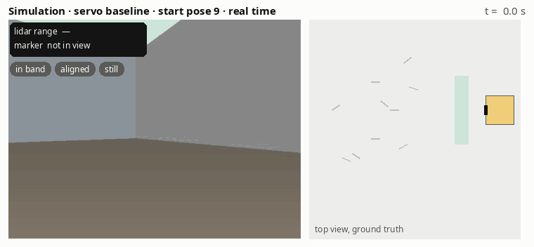
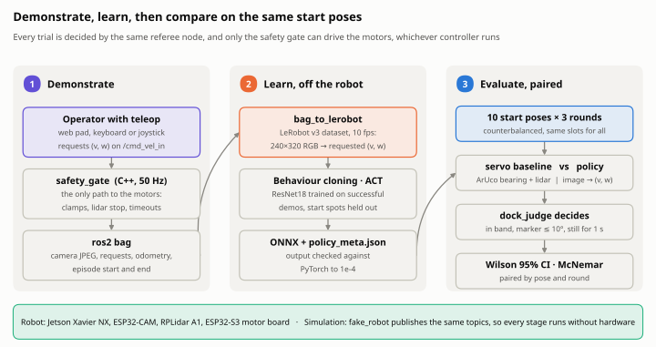
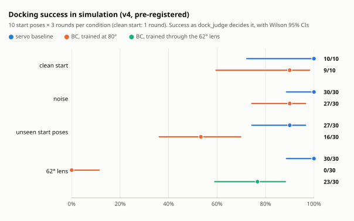
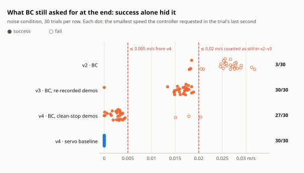
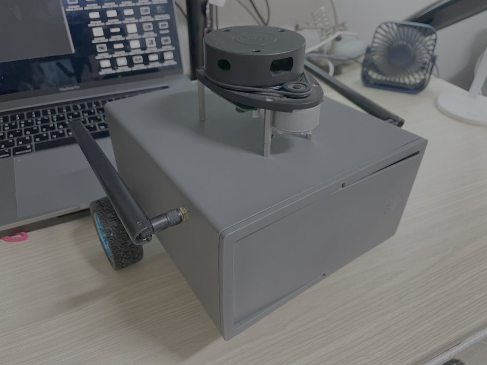
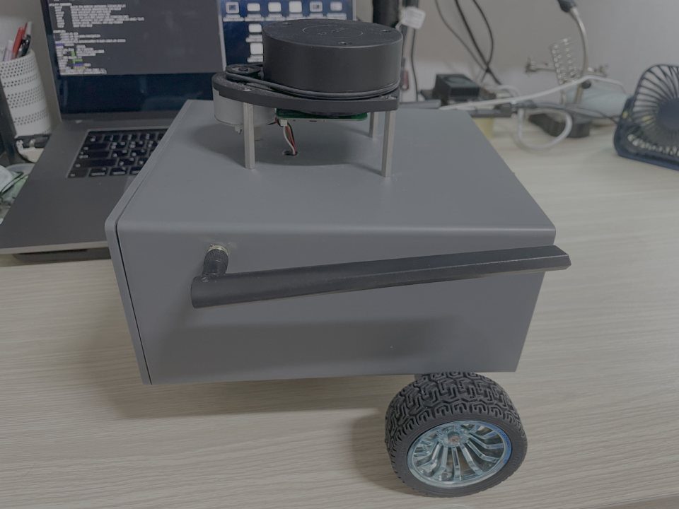
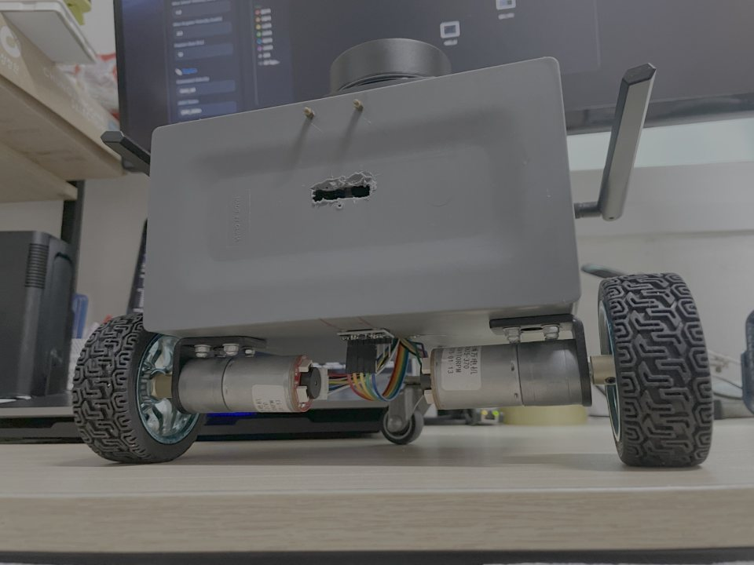
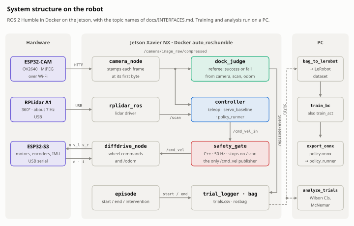
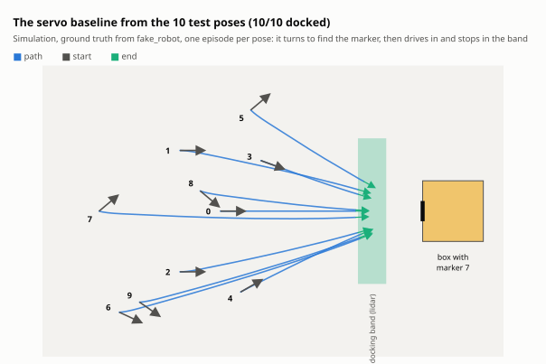

# camera-only-docking

[](LICENSE)
[](docs/GETTING_STARTED.md#run-the-tests)
[](docs/EXPERIMENTS.md)

**Learning to dock a low-cost robot from its camera alone, and measuring honestly whether that
beats a hand-written controller.**

<p align="center">
  
</p>
<p align="center"><sub>Simulation, real time. The classical servo baseline turns to find marker 7, drives in and stops in the docking band; the referee's three checks light up and it calls success. Left: the robot's camera, with the marker it detects. Right: ground truth from above.</sub></p>

The robot, [autoJetsonBot](https://github.com/jakhon37/autoJetsonBot), starts from one of 10
marked poses and has to stop facing a box with an ArUco marker, 0.18–0.32 m away. This repository
is everything around that task: teleoperated demonstrations recorded as a LeRobot dataset,
behaviour cloning (and ACT), the policy running as ONNX in a ROS 2 node, and paired trials
against a classical ArUco + lidar servo, judged by a referee node and reported with confidence
intervals.

> **Status, November 2026.** Every result below is from simulation. On the real robot the
> packages build and pass all 303 tests on its Jetson and `camera_node` reads its camera, but
> nothing has driven yet: [docs/HARDWARE.md](docs/HARDWARE.md) lists what is left.

## The idea

<picture>
  <source media="(prefers-color-scheme: dark)" srcset="docs/figures/overview-dark.svg">
  
</picture>

- **One referee.** `dock_judge` decides every trial from the lidar range, the marker's bearing and
  whether the robot and the controller's request are still. No method scores itself.
- **One path to the motors.** A C++ safety gate is the only `/cmd_vel` publisher, whether
  teleop, the servo or the policy is driving.
- **The same slots for every method.** 10 fixed start poses × 3 rounds in a counterbalanced
  order, so the outcomes pair up for McNemar's test.
- **A simulator with the robot's topics.** `fake_robot` publishes the same camera, lidar and
  odometry topics, so every stage runs and is tested without hardware.

## Results so far, in simulation

<picture>
  <source media="(prefers-color-scheme: dark)" srcset="docs/figures/results-dark.svg">
  
</picture>

The v4 run was pre-registered: its design, predictions and commands were committed before it ran.

- **Around the poses it learned from, BC comes close.** 27/30 against the servo's 30/30 with
  noise on. That gap is not significant, but 30 pairs cannot show the two are equal either.
- **From start poses outside its training spread, it falls behind.** 16/30 against 27/30 (exact
  McNemar p = 0.001).
- **A different lens breaks it.** Trained at the simulator's 80°, it stops short under the
  robot's 62° lens (0/30). Trained through that lens, it reaches 23/30.

### What the numbers almost hid

<picture>
  <source media="(prefers-color-scheme: dark)" srcset="docs/figures/stopping-dark.svg">
  
</picture>

At first BC scored 10/10 while still driving into the box: the judge then took "still" from
odometry alone, and the gate's slow zone made a creeping robot look stopped. Once the judge also
checked the request, BC fell to 0/10, because its demonstrations never contained a stop.
Re-recorded demonstrations brought it to 30/30, but by creeping at about 0.017 m/s, just under
the 0.02 m/s limit. So v4 was pre-registered with a 0.005 m/s limit and a servo whose
demonstrations end on a commanded stop. BC now ends at a median 0.003 m/s: close to a stop,
though not exactly zero. All four runs are written up in [docs/EXPERIMENTS.md](docs/EXPERIMENTS.md).

## The robot

<p align="center">
  
  
  
</p>

| Part | What it is |
|---|---|
| Compute | Jetson Xavier NX, JetPack 5.1.6, ROS 2 Humble in Docker |
| Camera | ESP32-CAM (OV2640), MJPEG over Wi-Fi, used at 320×240 and up to 10 fps |
| Lidar | RPLidar A1, about 7 Hz |
| Drive | ESP32-S3 with two geared DC motors, Hall encoders and an MPU6050 IMU, on USB serial |

The software is ready on the robot: everything builds and passes its tests on the Jetson,
`camera_node` reads and records the ESP32-CAM, and the simulated servo docks from all 10 poses on
the Jetson itself. Before anything drives, the camera link has to pass its check (the last
3-minute run missed by one 1 s gap), the new motor firmware has to be flashed, and the encoders
and lidar need calibrating. Details and measurements: [docs/HARDWARE.md](docs/HARDWARE.md).

## How it works

<picture>
  <source media="(prefers-color-scheme: dark)" srcset="docs/figures/architecture-dark.svg">
  
</picture>

- `camera_node` reads the ESP32-CAM's stream and stamps each frame when it starts to arrive, so
  a frame held up on Wi-Fi shows its true age.
- The controller is teleop, the servo baseline or `policy_runner`. Whichever it is, it only
  requests a speed on `/cmd_vel_in`.
- `safety_gate` turns requests into `/cmd_vel`: it clamps, slows and stops on what the lidar
  sees ahead, sends zero when requests stop, and blocks forward motion when scans stop.
- `dock_judge` ends every episode, and `trial_logger` writes one row per trial.

The tour is [docs/HOW_IT_WORKS.md](docs/HOW_IT_WORKS.md); the contract is
[docs/INTERFACES.md](docs/INTERFACES.md).

## Experiment design

<picture>
  <source media="(prefers-color-scheme: dark)" srcset="docs/figures/trajectories-dark.svg">
  
</picture>

The 10 test poses are never trained on: demonstrations come from 20 other spots, at least 10 cm
away. Poses 5, 6, 7 and 9 start with the marker out of view, so the robot has to search first.
The design, the four simulation runs and their limits are in
[docs/EXPERIMENTS.md](docs/EXPERIMENTS.md); the same protocol on the real robot is
[docs/PROTOCOL.md](docs/PROTOCOL.md).

## Get started

```bash
bash scripts/sim_e2e.sh servo          # the servo on the 10 test poses, in Docker (~5 min)
bash scripts/docker_test.sh humble     # build and test in a clean ROS 2 container
python tools/make_figures.py           # redraw the figures from results/ and config/
```

Training, deployment, the real robot and every test command: [docs/GETTING_STARTED.md](docs/GETTING_STARTED.md).

## Repository layout

| Path | What it is |
|---|---|
| [`ros2_ws/src/jbl_nodes`](ros2_ws/src/jbl_nodes) | Python ROS 2 nodes (3.8-compatible): camera, judge, servo, policy runner, logger, simulator, the `episode` and `camera_check` CLIs, launch files and parameters |
| [`ros2_ws/src/jbl_safety`](ros2_ws/src/jbl_safety) | the C++17 safety gate, its logic ROS-free and tested with gtest |
| [`tools/`](tools) | host tools: bag → LeRobot dataset, BC training, ONNX export, ACT, schedules, statistics, figures |
| [`scripts/`](scripts) | the Docker test matrix, the simulation pipeline and evaluation, recording on the robot |
| [`results/`](results) | the small outputs of every simulation run: trials, reports, provenance |
| [`docs/`](docs) | the pages below, the figures and the media |

## Documentation

| Page | What it covers |
|---|---|
| [Getting started](docs/GETTING_STARTED.md) | simulation, tests, the real robot, training, deployment |
| [How it works](docs/HOW_IT_WORKS.md) | the ROS graph, the safety gate, the judge, frame timing, the policy contract |
| [Experiments](docs/EXPERIMENTS.md) | the design, all four simulation runs, what they do and do not show |
| [Hardware](docs/HARDWARE.md) | the robot, its bring-up status, the camera measurements |
| [Interfaces](docs/INTERFACES.md) | the contract: topics, JSON schemas, parameters, dataset, policy I/O |
| [Protocol](docs/PROTOCOL.md) | the runbook for demonstrations and paired trials on the real robot |

## Limitations

- **Simulation only so far.** `fake_robot` has no motor deadband or latency, lens distortion,
  blur or rolling shutter, and its lighting changes only per episode.
- **BC imitates a scripted servo**, trained from scratch on a few thousand frames, so it is not
  expected to beat it here.
- **The intervals are optimistic.** The 3 rounds of one pose are correlated.
- **Success does not measure squareness.** "Facing the marker" is a bearing in the image, not the
  robot's heading to the box face.
- **ACT trains but cannot be deployed yet**, and nothing has driven on the real robot.

The full list is in [docs/EXPERIMENTS.md](docs/EXPERIMENTS.md#limitations).

## License

Apache-2.0, see [LICENSE](LICENSE).
