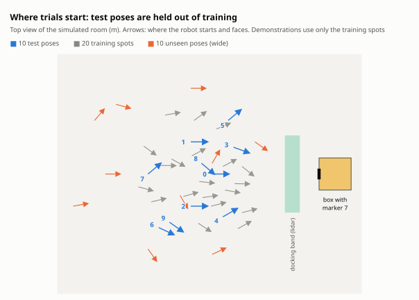
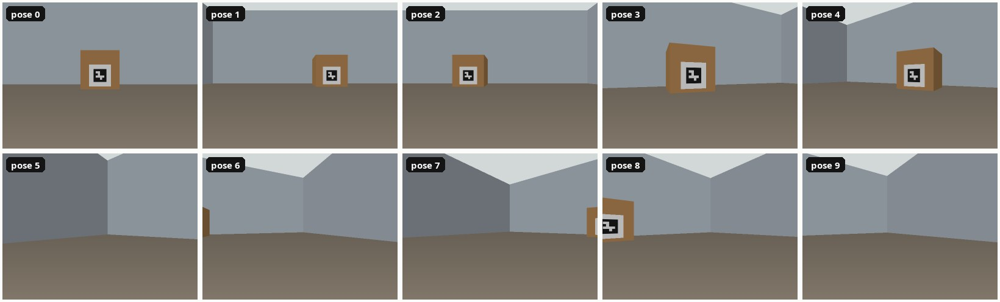
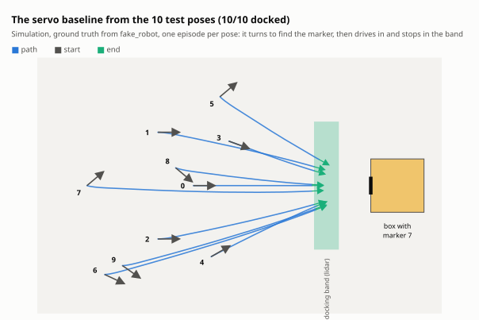
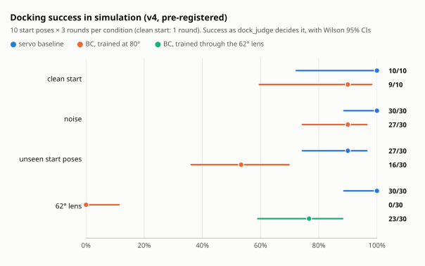
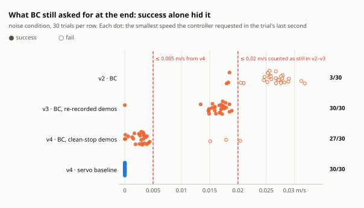

# Experiments

> **SIMULATION ONLY.** Every result on this page comes from `fake_robot`, not from the real
> robot. The real-robot protocol is [PROTOCOL.md](PROTOCOL.md); its status is in
> [HARDWARE.md](HARDWARE.md).

The question: does a policy trained on demonstrations dock as well as a hand-written controller,
from the same start poses, judged by the same rule? Four simulation runs so far; each fixed
something the previous one showed was measuring the wrong thing.

## Design

<picture>
  <source media="(prefers-color-scheme: dark)" srcset="figures/poses-dark.svg">
  
</picture>

- **Start poses.** 10 test poses, given relative to the box face
  ([start_poses.yaml](../ros2_ws/src/jbl_nodes/config/start_poses.yaml)) and marked on the floor
  on the real robot. Demonstrations come from 20 other training spots, each at least 10 cm from
  every test pose whatever the heading, so the test poses stay held out. The `wide` condition
  adds 10 poses outside the training spread: farther, wider and steeper.
- **What the camera sees at the start.** Through the simulator's 80° lens, poses 5, 6, 7 and 9
  start with the marker out of view, so the robot has to search:

  

- **Success** is the judge's rule ([INTERFACES.md](INTERFACES.md)): lidar range in
  [0.18, 0.32] m, marker 7 within 10° of the image centre, and still for 1 s, robot and request
  both; 30 s limit.
- **Pairing.** Every method runs the same pose × round slots, 10 poses × 3 rounds per condition,
  in a counterbalanced order, so outcomes pair up for an exact McNemar test. Success rates carry
  Wilson 95% intervals; paired differences carry Newcombe's interval.
- **Pre-registration.** v4's design, predictions and commands were committed before it ran
  ([PREREG.md](../results/sim_eval_v4_cleanstop/PREREG.md)).

<picture>
  <source media="(prefers-color-scheme: dark)" srcset="figures/trajectories-dark.svg">
  
</picture>

The paths above are a fresh run of `scripts/sim_e2e.sh --distro humble servo` on the robot's
Jetson (arm64, 7 November 2026, [provenance](../results/sim_showcase/provenance.txt)): one episode
per test pose, all 10 docked, in 9 to 29 s.

## The four runs

| Run | What changed | What it showed |
|---|---|---|
| Clean run | the pipeline end to end; the judge now also checks the request | BC 0/10: its demonstrations never stopped |
| v2 | noise, unseen start poses, the 62.2° lens | BC 3/30 with noise: it still never stopped |
| v3 | demonstrations re-recorded; stop examples weighted | BC 30/30, but by creeping under the 0.02 m/s limit |
| v4, pre-registered | still means ≤ 0.005 m/s; the servo latches its stop | BC 27/30 with noise, 16/30 from unseen poses |

<picture>
  <source media="(prefers-color-scheme: dark)" srcset="figures/results-dark.svg">
  
</picture>

<picture>
  <source media="(prefers-color-scheme: dark)" srcset="figures/stopping-dark.svg">
  
</picture>

These four runs ran in Docker containers on an x86 CPU. They show that the pipeline runs end to
end; they say nothing about how either method does on the real robot.

There are four runs. The **clean run** below has randomisation off and 1 round per pose. It is at
the ceiling for the servo (10/10) and the floor for BC (0/10), so it says nothing about how
either method degrades. The **harder evaluation (v2)** after it adds randomisation, start poses
beyond the training distribution and the robot's 62.2° lens, with 10 poses × 3 rounds per
condition. Its results are in [results/sim_eval_v2](../results/sim_eval_v2/SUMMARY.md). **v3**
re-records the demonstrations under the corrected judge, retrains BC and evaluates it under the
same conditions: [results/sim_eval_v3_bcfix](../results/sim_eval_v3_bcfix/SUMMARY.md). **v4**
changes the stop rules, adds demonstrations through the robot's lens, and was pre-registered
before it ran: [results/sim_eval_v4_cleanstop](../results/sim_eval_v4_cleanstop/SUMMARY.md) (the
last two sections below).

## Clean run (pipeline check; at ceiling for the servo, floor for BC)

Setup (`scripts/sim_e2e.sh`, October 2026):

- **Trials.** 10 test poses × 1 round per method. The `episode` CLI started each episode,
  `dock_judge` ended it, and `trial_logger` wrote the row. fake_robot's randomisation was off
  during the trials.
- **servo.** The classical ArUco-bearing + lidar-range baseline (`servo_baseline`).
- **bc.** ResNet18 trained from scratch on CPU for 5 epochs, on 40 scripted `servo_demo`
  demonstrations from 20 separate training spots (2 gain settings, randomisation on). The 10
  test poses were never trained on. The model was exported to ONNX (opset 13; ONNX Runtime
  matches PyTorch to 5.4e-7) and run by `policy_runner` with ONNX Runtime on CPU inside the
  ROS container.
- **Provenance.** The demonstrations and the BC model predate the repository's first commit
  (5a83553; the Jazzy demos also predate a later edit to `launch_common.py`). The servo and BC
  trials below were re-run on 29 October 2026 on 5a83553 plus uncommitted fixes (the review
  fixes to the judge, the gate and the tools). `results/sim_e2e/<distro>/provenance.txt`
  records per stage the commit and the number of changed paths, plus the image digest, the
  ONNX Runtime version and the model's sha256 (`7cfb1cbb…`, also in `bc_policy_meta.json`).
  The 45 MB `policy.onnx` is not in git.

| ROS 2 (container) | Method | Success | Wilson 95% CI | Time to dock, s | Final range error, cm | Final marker bearing, deg |
|---|---|---:|---:|---:|---:|---:|
| Jazzy (Python 3.12, ONNX Runtime 1.31.1) | servo | 10/10 | 72–100% | 13.8 (12.2–18.1) | 2.0 (2.0–2.0) | 3.7 (3.5–3.8) |
| Jazzy | bc | 0/10 | 0–28% | — | 2.0 (1.3–3.0) | 1.9 (1.2–2.3) |
| Foxy (Python 3.8, ONNX Runtime 1.10.0) | servo | 10/10 | 72–100% | 13.6 (12.5–18.2) | 2.0 (2.0–2.0) | 3.7 (3.4–3.9) |
| Foxy | bc | 0/10 | 0–28% | — | 2.0 (1.3–3.0) | 1.9 (1.1–2.3) |

Times and errors are median (IQR). Time to dock includes the judge's 1 s success hold; range
error is measured from the 0.25 m target; the marker bearing is the marker's angle from the
image centre, not the robot's heading to the box face. Paired exact McNemar test of bc against
servo on both distros: b = 10, c = 0, p = 0.002; difference in success rate −100 pp (95%
Newcombe CI −100 to −61 pp). All 10 bc failures are timeouts.

Training and runtime on the same CPU (4 cores):

- **Training.** 32 episodes / 3,801 frames for training, and 8 episodes / 948 frames from 4
  held-out spots for validation. Each epoch took 4–7 min. Validation MAE was 0.013 m/s and
  0.030 rad/s, against 0.038 m/s and 0.141 rad/s for always predicting the mean command.
- **Policy latency.** Inference took 23 ms (p50) and 65 ms (p99) on Jazzy, 22 ms and 40 ms on
  Foxy. Tick start to `/cmd_vel_in` took 27–29 ms (p50). At the start of a tick the newest
  frame was 45 ms (Jazzy) and 64 ms (Foxy) old (p50).
- **Safety gate timing.** The 50 Hz timer missed 7–13 deadlines per run of 9,000–17,000 ticks
  (≤ 0.13%); the period p99 was at most 24.8 ms. The worst single period, 341 ms in the Jazzy
  servo run, fell while a host test suite was running on the same CPU.

What this does and does not show:

- **The parts work together.** On Foxy, then the robot's distro, and on Jazzy, recording,
  conversion, training, export, ONNX Runtime inference in a ROS node, the judge, the logger and
  the statistics all ran.
- **The servo docks and stops by itself** from all 10 poses on both distros: it commands zero
  once the lidar range is at most 0.27 m (target + tolerance) and the marker is inside its ±4°
  deadband. The judge's hold can start a little earlier, while the servo still creeps at
  0.017–0.019 m/s, just under the 0.02 m/s "still" threshold. On Jazzy, 2 of the 10 successes
  (poses 4 and 5) were declared before the zero command came.
- **The trained policy never stops, so it never succeeds.** It reaches the docking band facing
  the marker from all 10 held-out poses, but in the last 5 s of every episode it still
  requested 0.021–0.032 m/s; the gate's slow zone cut that to about 0.002 m/s near its stop
  distance, and the judge, which now also requires the request on `/cmd_vel_in` to be still,
  ran each episode into its 30 s timeout. The cause is the training data: the demonstrations
  were recorded with the earlier judge, whose odometry-only "stopped" test (≤ 0.02 m/s) passed
  while the servo was still creeping inside the slow zone, so every demonstration ended before
  the servo commanded zero and the dataset holds no stop examples.
- **The earlier 10/10 for bc was an artefact.** Before the judge checked the request, the same
  `policy.onnx` scored 10/10 on both distros: every success was declared while the robot was
  still being driven forward, slowed below 0.02 m/s only by the gate. (The earlier servo
  successes were also declared while it was still creeping, before its own stop.)
- **"Facing the marker" is not "square to the box".** Ground truth at the end of each servo
  success (`/fake_robot/ground_truth` in the bags): poses 1–6 and 9 ended 16–29° off square
  with 8–15 cm sideways offset; only poses 0, 7 and 8 ended within 4° of square. The judge
  does not measure this.
- **The servo's times grew** from 9.7 s to 13.8 s (median, Jazzy) because the judge now waits
  for it to stop and the gate's forward corridor (`footprint_half_width`) slows oblique final
  approaches; poses 5 and 7 took 26–27 s of the 30 s budget.
- **Small bc final marker bearing** (1.9° against the servo's 3.7°) comes from its continuous
  output: the servo stops turning inside its ±4° deadband.
- **Both Foxy runs reuse the model** trained on the Jazzy recordings.

Reports with every table, the outcome breakdown and the chart:
[results/sim_e2e/jazzy/report.md](../results/sim_e2e/jazzy/report.md) and
[results/sim_e2e/foxy/report.md](../results/sim_e2e/foxy/report.md). The demonstration log, BC
metrics, split and `policy_meta.json` are next to them.

## Harder evaluation (v2)

Run with `scripts/sim_eval.sh` on Jazzy, 29 October 2026, using the same `policy.onnx`. It was
not retrained: the later fixes change neither its preprocessing nor its dataset format.

- **Conditions.** `fake_robot` ran with `randomize:=true` in all three, with one seed per
  condition:
  - `noise`: the test poses with the randomisation the demonstrations were recorded with
    (lighting gain and offset, pixel noise, wheel bias and slip, lidar noise, start jitter).
  - `wide`: 10 start poses outside the demonstrations' distance / lateral / heading box
    (`config/sim_eval_wide_poses.yaml`: far, wide, steep, near).
  - `hfov62`: the robot's 62.2° lens in place of the simulator's 80°. The judge and the servo
    were told the true HFOV; BC was trained at 80°.
- **Trials.** 10 poses × 3 rounds per method per condition, with servo and bc interleaved in
  one launch in a `tools/make_schedule.py` order. That makes 180 trials: all scored, none
  aborted.
- **Outcomes.** The primary outcome is the unchanged judge rule. The secondary outcome is
  *zone reached*: in band and aligned for ≥ 1 s, with the stop requirement dropped, taken from
  the judge's status in the bags.

| Condition | Method | Success (judge) | Wilson 95% CI | b / c vs servo, exact McNemar p | Time to dock, s | Zone reached (stop ignored) | Time to zone, s | Min requested v, last 1 s, m/s |
|---|---|---:|---:|---:|---:|---:|---:|---:|
| noise | servo | 27/30 | 74–97% | — | 14.8 (12.7–18.1) | 30/30 | 9.3 | 0.000 |
| noise | bc | 3/30 | 3–26% | 24 / 0, p = 1.2e-7 | 13.2 (13.2–21.7) | 30/30 | 10.2 | 0.026 |
| wide | servo | 25/30 | 66–93% | — | 21.0 (17.8–22.0) | 30/30 | 14.9 | 0.000 |
| wide | bc | 1/30 | 1–17% | 24 / 0, p = 1.2e-7 | 21.8 | 30/30 | 16.6 | 0.027 |
| hfov62 | servo | 28/30 | 79–98% | — | 15.1 (12.8–18.7) | 30/30 | 9.3 | 0.000 |
| hfov62 | bc | 20/30 | 49–81% | 8 / 0, p = 0.008 | 25.0 (21.9–26.9) | 30/30 | 15.2 | 0.019 |

Times are medians (IQR) and requested speeds are medians over trials. The full tables, with
final range, bearing, ground-truth squareness and offset, collisions and the clean reference
row, are in [results/sim_eval_v2/SUMMARY.md](../results/sim_eval_v2/SUMMARY.md). Each
condition's `report.md` (per-pose results, latency, gate timing), `trials.csv`,
`schedule.csv`, `episodes_gt.csv` and `provenance.txt` are in
`results/sim_eval_v2/<condition>/`.

What v2 shows and does not show:

- **The methods separate on stopping, not on getting there.** The servo beats BC on the judge's
  rule in every condition. Yet both reach the docking zone in 30/30 trials everywhere,
  including from the out-of-distribution poses, with BC 1–6 s slower to get there.
- **BC never commanded a stop in any trial.** Its smallest request in the last second was
  always ≥ 0.016 m/s. Each BC success is its leftover creep dipping under the judge's 0.02 m/s
  "still" threshold. Its 20/30 under the 62.2° lens comes from the narrower view making the
  marker look closer, so BC creeps at about 0.019 instead of 0.027 m/s; it is not robustness to
  the lens.
- **The servo's 10 failures come from three mechanisms.**
  - Pose 5 (5 of 6 trials in `noise` and `hfov62`): lidar noise toggles its request across its
    0.27 m stop range, so the 1 s hold never completes.
  - Wide pose 4 (2/3): about 39° off square, it pushes against the gate as BC does.
  - Wide pose 9 (3/3): it reaches the zone only at 26–27 s of the 30 s limit.

  Nothing collided.
- **What it does not show.**
  - How either method does on the robot (sim to sim, same renderer as the training images).
  - Out-of-distribution lighting (`noise` uses the training magnitudes).
  - Actuation latency (`fake_robot` has no command delay).
  - Independent trials: 3 rounds of the same pose are correlated, so the CIs are too narrow.

## BC retrained with stop examples (v3)

Run on Jazzy, 29 October 2026; the full write-up is in
[results/sim_eval_v3_bcfix/SUMMARY.md](../results/sim_eval_v3_bcfix/SUMMARY.md).

- **Data.** The 40 demonstrations were re-recorded with v1's recipe (spots, gains, seeds) under
  the corrected judge. BC was retrained with v1's command (`bc_v2`, sha256 `f6e0b754…`).
- **Remedy.** One pre-registered remedy was tried: full-stop frames weighted 30× in the loss
  (`bc_v2sw`, `e018fd40…`).
- **Pairing.** Each new arm ran bc-only (`sim_eval.sh --methods`) and was paired by pose ×
  round with the v2 session's servo and BC v1 rows (for `clean_ref`, the clean run's)
  (`--pair-with`). The randomised conditions share seeds and schedules across sessions, not
  noise draws.

| Condition | servo | bc (v1) | bc_v2 | bc_v2sw | bc_v2 vs servo, b / c, exact p | bc_v2 vs bc, b / c, exact p | Stop commanded, bc_v2 / bc_v2sw |
|---|---:|---:|---:|---:|---:|---:|---:|
| clean_ref | 10/10 | 0/10 | 10/10 | 10/10 | 0 / 0, p = 1 | 0 / 10, p = 0.002 | 0/10 / 0/10 |
| noise | 27/30 | 3/30 | 30/30 | 30/30 | 0 / 3, p = 0.25 | 0 / 27, p = 1.5e-8 | 1/30 / 1/30 |
| wide | 25/30 | 1/30 | 25/30 | 22/30 | 3 / 3, p = 1 | 0 / 24, p = 1.2e-7 | 0/30 / 0/30 |
| hfov62 | 28/30 | 20/30 | 0/30 | 0/30 | 28 / 0, p = 7.5e-9 | 20 / 0, p = 1.9e-6 | 29/30 / 30/30 |

What v3 shows:

- **The corrected judge did not give the data clean stops.** Only 2 of the 40 new
  demonstrations requested zero for their whole last second. The judge still calls a request of
  up to 0.02 m/s still, the servo's heading-scaled creep is just below that, and lidar noise
  toggles its 0.27 m stop. Full-stop labels went from 0.4 % to 3.1 % of frames. On the docked
  view, 20 % of labels are stops and 80 % creep at ~0.019 m/s.
- **BC v2 learned the average.** Offline, on held-out docked-view frames labelled a full stop,
  it predicts 0.013 m/s (BC v1: 0.024).
- **BC v2 now passes the judge by creeping, not by stopping.** With the 80° lens it requests
  ~0.017 m/s and commands a stop in 1 of 70 trials. The judge counts that creep as still, so BC
  v2 matches the servo there. (That 1, and `bc_v2sw`'s 1/30 in `noise`, turned out to be the
  policy runner's fallback zero on a stale frame, not a request of the policy; found while
  preparing v4, which counts stops without them.)
- **Under the 62.2° lens, BC v2 stops short.** The marker looks 1.39× larger, so BC v2 stops at
  ~0.34 m, just outside the band: 0/30, against BC v1's creep-driven 20/30.
- **The stop weighting changed the offline numbers, not the closed-loop outcome.** It brought
  the offline stop prediction to 0.004 m/s, but in closed loop the judge's hold completes at
  ~0.277 m while the request is still 0.012–0.019 m/s, before the stop view is reached.
- **The headline numbers are a threshold effect.** BC's improvement on the success rule comes
  from the 0.02 m/s threshold, not from learning to stop. Testing stopping needs demonstrations
  that end on a commanded stop.

## Clean-stop protocol (v4; pre-registered)

v3 showed that the judge's "still" threshold, not a learned stop, decided the BC results. From
v4 on, two defaults change; [results/sim_eval_v4_cleanstop/PREREG.md](../results/sim_eval_v4_cleanstop/PREREG.md)
has the design, the predictions and the commands.

- **Judge.** A request on `/cmd_vel_in` counts as still only at |v| ≤ 0.005 m/s (`dock_judge`
  `request_still_v`; it was 0.02 m/s, the odometry limit). Creep of 0.012–0.019 m/s, which the
  v3 servo and BC ended on, no longer passes as a stop.
- **Servo.** A stop latch with hysteresis: v is exactly 0 once the range estimate is ≤ 0.27 m
  and stays 0 until it is above 0.30 m (`servo_baseline` `stop_hysteresis` 0.03 m), so lidar
  noise cannot toggle the stop and its successful demonstrations end on a commanded stop.
- **Tools.** `scripts/sim_e2e.sh --hfov 1.0856` records demonstrations through the robot's
  lens; `SIM_CPUSET=0-2` pins the simulation container of `sim_e2e.sh` and `sim_eval.sh`.
  Added after v4: `config/sim.yaml` sets `policy_runner`'s `intra_op_threads: 2`, because ONNX
  Runtime's default pool (0, used by v4 and every earlier run) is sized from the host's 4 cores
  and oversubscribed the 3-core cpuset
  ([TIMING.md](../results/sim_eval_v4_cleanstop/exploratory/TIMING.md)); `intra_op_threads: 0`
  restores it.
- **Analysis.** `stop_labels.py bags` writes the largest request of each demonstration's last
  second unrounded, so an exact stop can be read from the CSV. The controllers also send zero
  on stale input, and that stop is not the controller's decision. `sim_eval_summary.py`
  therefore counts "stop commanded" on the controller's own requests, without the policy
  runner's fallback zeros (exactly (0, 0), sent on a missing or too old frame, as on the tick
  that follows at once an inference that overran its 100 ms period). It flags successes whose
  last second had fewer than 5 camera frames or fresh policy inferences, or any fallback zero.
- **Run checks.** `sim_eval.sh` now ends with a nonzero status when a report fails (the trials
  are kept; rerun with `--report-only`), and its provenance counts the paths that differ from
  the commit without the run's own result files.
- **The numbers above used the old rules.** The clean run, v2 and v3 are reproduced with
  `request_still_v: 0.02` and `stop_hysteresis: 0.0` (e.g. in `config/sim.yaml`), and
  `policy_runner`'s `intra_op_threads: 0` (ONNX Runtime's default pool, which they ran with).

## Clean-stop protocol: results (v4)

> **SIMULATION ONLY.** `fake_robot` in `ros:jazzy-ros-base` containers on an x86 CPU, 29 October
> 2026. Nothing was measured on autoJetsonBot.

The run followed the pre-registered commands once each, from the pre-registration commit
(b72ba83), with no infrastructure failure. Its one deviation: the write-up file was saved after
the run, with the review's edits listed in its [run log](../results/sim_eval_v4_cleanstop/RUN_LOG.md).
The write-up is in
[results/sim_eval_v4_cleanstop/SUMMARY.md](../results/sim_eval_v4_cleanstop/SUMMARY.md).

- **Demonstrations.** 40/40 succeeded through the simulator's 80° lens (set A) and 39/40 through
  the robot's 62.2° lens (set B; in `fake_robot` only the pinhole camera's HFOV changes). Every
  success requested exactly v = 0 for its whole last second. Full-stop frames at the end make up
  7.1 % of set A (v3: 2.5 %).
- **Models.** `bc_v4` was trained on set A (sha256 `ed36c9b6…`) and `bc_v4_62` on set B
  (`ea29531c…`), each with v3's BC v2 training command unchanged (no stop weighting).

| Condition | servo | bc_v4 | bc_v4_62 | bc_v4 vs servo, b / c, exact p | Stop commanded, bc_v4 | BC successes flagged stale |
|---|---:|---:|---:|---:|---:|---:|
| clean_ref | 10/10 | 9/10 | — | 1 / 0, p = 1 | 9/10 | 1 |
| noise | 30/30 | 27/30 | — | 3 / 0, p = 0.25 | 27/30 | 10 |
| wide | 27/30 | 16/30 | — | 11 / 0, p = 0.001 | 18/30 | 3 |
| hfov62 | 30/30 | 0/30 | 23/30 | 30 / 0, p = 1.9e-9 | 30/30, short of the band | 0 (bc_v4), 7 (bc_v4_62) |

In `clean_ref` and `noise`, the `bc_v4` trials that commanded a stop are exactly its successes
(a success requires it); none of its 4 failures there, all on pose 5, did.

What v4 shows:

- **All five pre-registered predictions were met as scored**, which is how the
  pre-registration reads them. With the 21 BC successes that the validity check flags counted as
  failures, P4 (`bc_v4` 17/30 in `noise`, below 24; C1 there 13 / 0) and P5 (`bc_v4_62` 16/30,
  below 20) would not be met (see Timing).
- **In distribution, BC brings its request below 0.005 m/s, but not to zero.**
  - It commanded a stop in 36 of 40 `clean_ref` + `noise` trials, at a median ground-truth
    lidar range of 0.264 m.
  - It scored 9/10 and 27/30 against the servo's 10/10 and 30/30. That difference is not
    significant, but with this little power it is not evidence of equivalence either. With
    flagged successes counted as failures, `noise` is 17/30 against 30/30.
  - Its stop is a request just under the judge's limit: the largest request of each success's
    last second was 0.003–0.005 m/s (exploratory).
- **From out-of-distribution poses, BC is worse:** 16/30 against 27/30 in `wide` (11 / 0,
  p = 0.001 per slot; the 11 pairs come from 5 of the 10 poses).
- **Lens.**
  - Trained at 80°, BC stops short under the robot's lens (0.349 m; 0/30).
  - Trained through that lens, it no longer stops short (zone reached 30/30) and scores 23/30
    (against `bc_v4`: b / c = 0 / 23, p = 2.4e-7). That is still below the servo's 30/30
    (7 / 0, p = 0.016; all 7 on poses 1, 5 and 7).
  - The two BC arms ran in different sessions and trained on 32 and 30 episodes.
- **Timing.**
  - Policy inference was 2–3 times slower than in v3 (p50 60–69 ms, p99 116–123 ms). An
    exploratory follow-up after the run traced that to the 3-core cpuset combined with ONNX
    Runtime's default thread pool
    ([TIMING.md](../results/sim_eval_v4_cleanstop/exploratory/TIMING.md)). Consistent with the slow
    inference, 37 of 130 policy trials had a fallback zero in their last second, and 21 BC
    successes are flagged stale; the follow-up reproduced only part of those fallback zeros.
  - Counted as failures, they would leave `bc_v4` at 17/30 in `noise` and `bc_v4_62` at 16/30.
  - An exploratory check made after seeing the data found that in all 21, the policy's own
    requests already met the still rule. Its scripts are in
    [results/sim_eval_v4_cleanstop/exploratory](../results/sim_eval_v4_cleanstop/exploratory/);
    the bags they read are not in git.

What it does not show (details in the write-up):

- Anything about the real robot.
- Independent trials: the 3 rounds of a pose are correlated, so the CIs are too narrow and the
  p values too small, and no correction is applied across the 6 tests.
- Same-session pairs or controlled load for the `bc_v4_62` comparisons: that arm ran in a
  session of its own, and timing was not controlled.
- Training variance: there is one training seed per model.
- A like-for-like comparison with the tables above: v4 counts a request as still only at
  |v| ≤ 0.005 m/s and the servo latches its stop; the clean run, v2 and v3 used 0.02 m/s and no
  latch.

## On the real robot

The same protocol, with a printed marker, a weighted box and the 10 poses taped on the floor, is
[PROTOCOL.md](PROTOCOL.md). No demonstrations or trials have been recorded on the robot yet;
[HARDWARE.md](HARDWARE.md) has what is left to do and the camera measurements so far.

## Limitations

- **Simulation only so far.** `fake_robot` is a unicycle with acceleration limits, optional
  wheel slip and bias, a flat-shaded pinhole camera and an ideal 2D lidar: no motor deadband or
  latency, no lens distortion, blur or rolling shutter, no lighting changes beyond a per-episode
  gain. Sim success rates say the pipeline works end to end, not how a policy does on the robot.
- **The BC policy is trained on scripted servo demonstrations**, from scratch, on CPU, from a
  few thousand frames. It imitates the baseline, so it cannot be expected to beat it; the
  simulation run is a pipeline check with honest numbers, not a learning result. The harder
  simulation evaluation (v2: randomisation on, out-of-distribution poses, the 62.2° lens) is in
  the results above. It does not cover out-of-distribution lighting or actuation latency.
- **Before v4, no BC model here reliably commanded a stop inside the docking band; v4's gets its
  request just under the 0.005 m/s threshold, not to zero.**
  - BC v1's demonstrations were recorded with the earlier, odometry-only judge and hold no
    stop examples.
  - The v3 re-recording, under the judge that also checks the request, still ends mostly on
    creep. The judge's 0.02 m/s "still" threshold is above the servo's slowest creep, and lidar
    noise toggles its stop.
  - BC v2 and the stop-weighted BC therefore pass the judge by creeping. Under the 62.2° lens
    they stop short of the band (results/sim_eval_v3_bcfix).
  - Demonstrations that end on a commanded stop need a stricter demo-ending rule or a servo
    with hysteresis on its stop range. The v4 protocol adds both (results/sim_eval_v4_cleanstop,
    simulation only). BC trained on its demonstrations requests less than 0.005 m/s at the end
    of 36 of 40 in-distribution trials, but a few mm/s or less, not zero.
  - From out-of-distribution poses it succeeds in 16/30 (the servo: 27/30), and under a lens it
    was not trained on it stops short (0/30).
- **Recorded actions are requests, not motion.** `action` is `/cmd_vel_in`, before the gate
  scales or blocks it near the box. The bags also hold `/cmd_vel` and the gate status, but the
  dataset does not use them yet.
- **ACT is not deployable yet** (action chunks + odometry input vs the image-only, single-action
  ONNX contract); `train_act.sh` trains it, nothing exports or runs it on the robot.
- **Nothing has driven on the real robot, and on-board inference is not set up.** The real
  camera connects, but its rate has swung between 2 and 10 fps for reasons not yet known, and the
  motor firmware and the encoders have known problems (PROTOCOL, "Before anything drives"). The
  lidar's 0° may point backwards on
  this robot (`forward_angle` may be π): calibrate it (PROTOCOL §4) before anything drives.
- **The simulator's chassis is not the URDF's.** `fake_robot` puts the bumper 0.033 m ahead of
  the lidar (the 0.25 m docking range is then ≈ 0.22 m bumper to box); the URDF puts it 0.094 m
  ahead (≈ 0.16 m) and the camera at x = 0.15 m. The success band and the gate thresholds are
  lidar ranges, so they do not change, but measure the real robot (PROTOCOL §4).
- **The success rule does not measure squareness.** "Facing the marker" is a bearing in the
  image, not the robot's heading to the box face or its sideways offset (see the simulation
  results).
- **Episode events need care.** `/episode/event` is transient-local and a fresh `episode` CLI
  process can take up to ~3.5 s to reach every node (Fast DDS discovery); the CLI waits for
  that (or for `--expect N` subscribers in scripts) and reports a partial delivery with exit 3.
  Use it, not `ros2 topic pub`.
