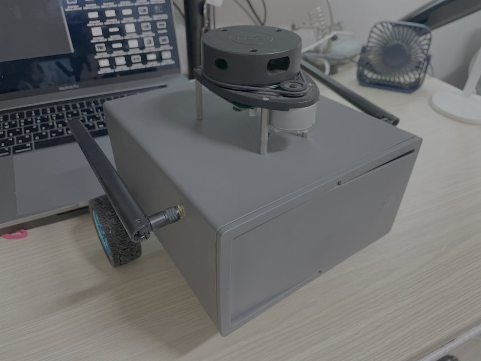
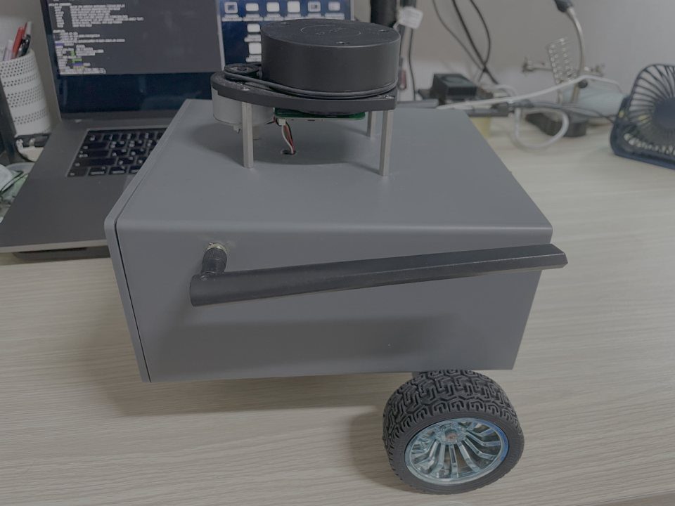
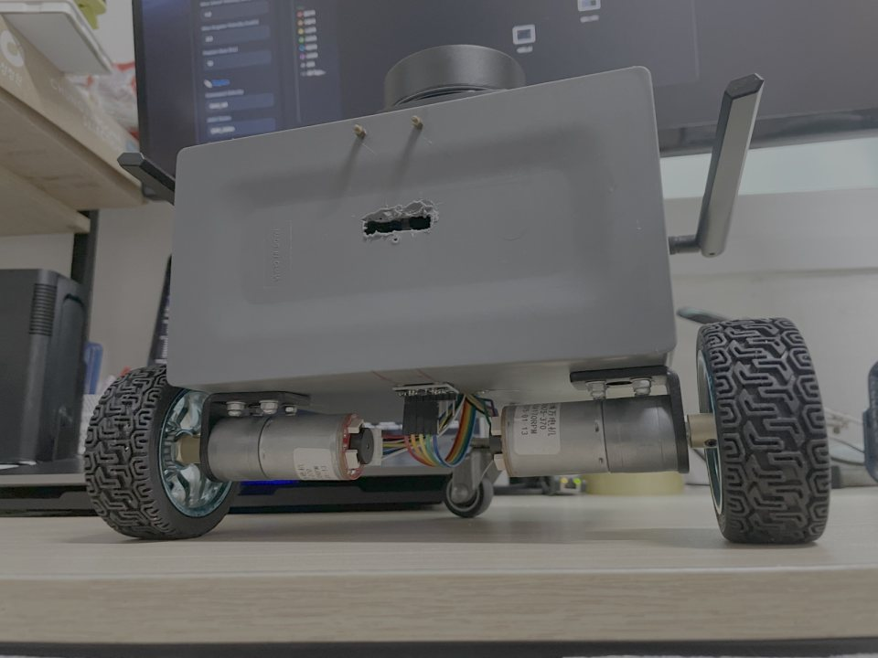

# The robot

<p align="center">
  
  
  
</p>
<p align="center"><sub>autoJetsonBot, photographed before the ESP32-CAM was fitted. Photos from its <a href="https://github.com/jakhon37/autoJetsonBot">repository</a>.</sub></p>

[autoJetsonBot](https://github.com/jakhon37/autoJetsonBot) is a two-wheeled differential-drive
robot with its own repository for the bring-up, mapping and navigation. This page is what
camera-only-docking uses from it and how far its bring-up has got. The facts are as of
7 November 2026.

## Components

| Part | What it is | Link to the Jetson | Software |
|---|---|---|---|
| Computer | Jetson Xavier NX dev kit, JetPack 5.1.6 (L4T R35.6.5) | — | ROS 2 Humble in Docker (`auto_ros:humble`, Ubuntu 22.04, Python 3.10) |
| Camera | AI-Thinker ESP32-CAM (OV2640), used at 320×240 | Wi-Fi: MJPEG over HTTP, at most 10 fps | [myESP32CAM-BLACKBOX](https://github.com/jakhon37/myESP32CAM-BLACKBOX) firmware; `camera_node` |
| Lidar | RPLidar A1, 360°, about 7 Hz | USB (CP2102) | `rplidar_ros` |
| Drive | ESP32-S3 with two geared DC motors, Hall encoders, an MPU6050 IMU; front caster | USB serial: `m v_l v_r` down, encoder and IMU lines up at 50 Hz | [MOTOR-ESP32S3](https://github.com/jakhon37/MOTOR-ESP32S3) firmware; `diffdrive_node` |
| Geometry | wheel separation 0.212 m, wheel radius 0.034 m | | |

## Bring-up status

What works:

- **Build and tests.** Both packages build and pass all 303 tests on the Jetson, in the robot's
  own image and in clean Foxy and Jazzy images.
- **Camera.** `camera_node` reads the ESP32-CAM, sets its frame size on every connection,
  reconnects by itself, and `scripts/record_robot.sh` records it to a bag.
- **The pipeline on the robot's computer.** All 10 servo episodes dock in simulation on the
  Jetson's arm64 Humble (the paths in [EXPERIMENTS.md](EXPERIMENTS.md#design)).

What blocks driving, from read-only checks
([PROTOCOL.md, "Before anything drives"](PROTOCOL.md#before-anything-drives) has the details):

- **Camera link.** It has to pass `camera_check` where it will be used; the last run missed by
  one gap (below).
- **Motor power.** The motor firmware in the repository gives every wheel request from 0.01 to
  0.25 m/s the same power, so the servo could not steer finely. A replacement with quadrature
  encoders and closed-loop speed control is written and compiled, not flashed.
- **Encoders.** They counted 344–387 per wheel turn by hand against 3,436 configured, so
  odometry reads about a tenth of the real speed.
- **Lidar.** Its forward direction is not calibrated yet, and only 40% of its returns were valid.
- **Mount.** The camera is not mounted on the robot yet, and its lens is unmeasured.

## The camera link

`ros2 run jbl_nodes camera_check` runs `camera_node` and a constant policy on a private ROS
domain for 3 minutes and checks what the docking nodes would see: at least 9 fps, no gap over
0.5 s, under 5% of policy ticks falling back to zero on a stale frame, and a view that is not
nearly black. Measured so far, camera not yet mounted:

| When (November 2026) | View | Rate | Longest gap | Fallback zeros | Verdict |
|---|---|---:|---:|---:|---|
| 6th, 13:25 | room | 9.8 fps | under 0.5 s | not measured | before the check existed |
| 7th, 00:30 | room | 2.2 fps | 5.5 s | 71% | would fail |
| 7th, 02:50 | nearly black | 9.6 fps | 0.46 s | 2.1% | not representative |
| 7th, 11:05 | lit room | 9.85 fps | 1.00 s | 1.5% | fail: one gap |

The slow periods are not the reader (OpenCV and a plain socket reader were as slow) and not
frame size alone; their cause is still unknown. If the link cannot pass, the fallback is a USB
webcam on the Jetson (`device: "0"`).

## Where things live on the Jetson

This repository is cloned inside the autoJetsonBot checkout, so the robot's container sees it at
`/autonomous_ROS/camera-only-docking`; its `COLCON_IGNORE` keeps autoJetsonBot's own build out of
it. The tests run in a container of their own, which cannot reach the running motor bridge:

```bash
IMAGE=auto_ros:humble bash scripts/docker_test.sh humble
```

[GETTING_STARTED.md](GETTING_STARTED.md#on-the-real-robot) has the build and recording commands.
