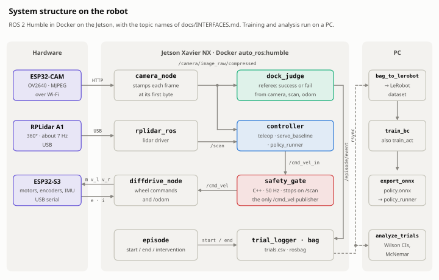

# How it works

<picture>
  <source media="(prefers-color-scheme: dark)" srcset="figures/architecture-dark.svg">
  
</picture>

The contract every component follows (topics, JSON schemas, parameters, geometry, the dataset and
the policy I/O) is [INTERFACES.md](INTERFACES.md). This page is the tour: the graph, then the
design decisions behind it.

## The graph

The contract (topics, JSON schemas, parameters, geometry, dataset schema, policy I/O, success
rule) is [docs/INTERFACES.md](INTERFACES.md). On the robot `camera_node`, the RPLidar
driver and `diffdrive_node` provide the sensors and motors; in simulation `fake_robot` provides
all three with the same topics.

```text
 SENSORS  (robot: camera_node, rplidar, diffdrive_node   |   simulation: fake_robot publishes all three)
   /camera/image_raw/compressed   JPEG 10-15 Hz, capture stamp ─▶ servo_baseline, policy_runner, dock_judge
   /scan                          LaserScan ~10 Hz          ──▶ safety_gate, servo_baseline, dock_judge
   /odom                          measured v, w             ──▶ dock_judge

 CONTROL  (one source at a time)
   teleop  |  servo_baseline  |  policy_runner (onnxruntime | tensorrt | torch)
        │
        │  /cmd_vel_in   requested (v, w)  ── the dataset's action; dock_judge's "stopped" needs it still too
        ▼
   safety_gate  (C++, 50 Hz: clamp, slow / stop on the front lidar sector, command and scan timeouts)
        │──▶ /cmd_vel              the only topic the motors obey ──▶ diffdrive_node | fake_robot
        └──▶ /safety_gate/status   2 Hz JSON: state, front_min_m, timer jitter ──▶ dock_judge (obstacle rule)

 EPISODES AND REFEREE
   episode CLI ── "start <method> <pose_id> <round>" ──┐
   dock_judge  ── "end success" | "end fail <reason>" ─┴─▶ /episode/event ──▶ fake_robot (teleport to the pose),
                                                                              controllers (enable / disable),
                                                                              dock_judge (start the clock),
                                                                              trial_logger ──▶ trials.csv
   dock_judge    ──▶ /dock_judge/status  10 Hz JSON: bearing, range, in_band, aligned, stopped, success
   policy_runner ──▶ /policy/latency     JSON per inference: preprocess, infer, total, image age

 OFFLINE  (host, Python 3.12)
   ros2 bag record ─▶ bag_to_lerobot.py ─▶ LeRobot v3 dataset ─▶ train_bc.py ─▶ export_onnx.py
       ─▶ policy.onnx + policy_meta.json ─▶ policy_runner (ONNX Runtime off-board; on-board not set up yet)
   trials.csv + bags ─▶ analyze_trials.py ─▶ report.md, success.png
```

| Package / dir | What it is |
|---|---|
| `ros2_ws/src/jbl_safety` | C++17 safety gate: ROS-free `SafetyGate` logic (gtest) + node; forward sector check with lidar dead-zone handling, command/scan timeouts, clamps, timing stats |
| `ros2_ws/src/jbl_nodes` | Python (3.8-compatible) nodes: `camera_node`, `dock_judge`, `servo_baseline`, `policy_runner`, `trial_logger`, `fake_robot`, the `episode` and `camera_check` CLIs, shared preprocessing, launch files and params |
| `tools/` | Host tools (Python 3.12, `requirements-tools.txt`): bag → LeRobot conversion, BC training, ONNX export, ACT training wrapper, TensorRT build script, marker generator, trial schedule, analysis and statistics |
| `docs/` | `INTERFACES.md` (contract), `PROTOCOL.md` (real-robot runbook) |
| `scripts/` | `docker_test.sh` (build + test on Foxy/Humble/Jazzy), `sim_e2e.sh` (whole pipeline in simulation), `sim_eval.sh` + `sim_eval_summary.py` (the harder paired evaluation), `stop_labels.py` (stop examples in demos, datasets and models), `record_robot.sh` (demos on the robot) |
| `results/sim_e2e/` | Small outputs of the simulation run: trial CSVs, `report.md`, `success.png`, training metrics |

Launch files (`ros2 launch jbl_nodes <file> --show-args` lists every argument):

| Launch file | Nodes |
|---|---|
| `sim_dock.launch.py` | `fake_robot`, `safety_gate`, `dock_judge`, `trial_logger` + one controller chosen by `method` / `controller` (`servo_baseline`, `policy_runner` with `model_path` and `backend`, or none) |
| `robot_record.launch.py` | `camera_node`, `safety_gate` (respawned), `dock_judge`, `trial_logger` (+ `servo_baseline` with `with_servo:=true`); teleop is external |
| `robot_policy.launch.py` | the same + `policy_runner` (`model_path`, `backend`, `method`) |

All three take `bag:=<new dir>` to record the INTERFACES topic list, `trials_csv:=`,
`params_file:=` / `extra_params_file:=`, and `forward_angle:=` / `hfov_rad:=` overrides that
reach every node that uses them. Parameters live in `config/sim.yaml` and `config/robot.yaml`
(robot calibration goes in its `/**` section once, so the gate, the judge and the baseline
cannot disagree).

## Design decisions

- **One referee for every method.** `dock_judge` decides each trial from the lidar's front range,
  the marker's bearing in the image, odometry, and the controller's own request on
  `/cmd_vel_in`. Success needs all of in band (0.18–0.32 m), aligned (marker within 10°) and still
  for 1 s; a trial fails after 30 s, on an operator intervention, or when the gate holds the
  robot against something for 2 s while it is not aligned. No controller scores itself, and the
  rule is the same on the robot and in simulation.
- **Only the safety gate drives the motors.** Teleop, the servo baseline and the policy all
  publish a *request* on `/cmd_vel_in`. `safety_gate` (C++, 50 Hz, its logic ROS-free and under
  gtest) turns that into `/cmd_vel`: it clamps speeds, and slows and stops forward motion on
  what the lidar sees in the front sector and a ±0.15 m corridor ahead. It publishes zero when the
  requests stop, and blocks forward motion when the scans stop.
- **Frames carry the time they were taken.** `camera_node` stamps each frame when its first byte
  arrives from the ESP32-CAM (`jbl_nodes/mjpeg_source.py`), so a frame held up on Wi-Fi shows
  its true age. `policy_runner` publishes a zero instead of acting on a frame older than 0.2 s.
  `dock_judge` and `servo_baseline` age frames by arrival (limit 0.5 s).
- **The policy contract is one image in, one (v, w) out.** Training and the robot share one
  preprocessing module (`jbl_nodes/preprocess.py`); `export_onnx.py` refuses a model whose ONNX
  output differs from PyTorch by more than 1e-4; `policy_runner` checks `policy_meta.json`
  (input size, normalisation, action scale) before loading the model.
- **The simulator speaks the robot's topics.** `fake_robot` (`jbl_nodes/sim_world.py`) is a
  unicycle with acceleration limits, an ideal 360-beam lidar and a flat-shaded pinhole camera,
  with optional wheel slip and bias, start jitter, lidar and pixel noise. It also publishes its
  ground truth, which the experiment figures use.
- **Episodes are events.** `/episode/event` carries `start <method> <pose_id> <round>`, `end ...`
  and `intervention ...`, reliable and transient-local, so a late node still sees the start. The
  `episode` CLI waits for discovery before it publishes, because a fresh process can take seconds
  to reach every node.
- **Python 3.8 to 3.12, three ROS 2 distros.** The nodes run on Foxy, Humble and Jazzy and are
  tested on all three, on x86 and on the robot's arm64 Jetson. The host tools use Python 3.12 and
  LeRobot.
